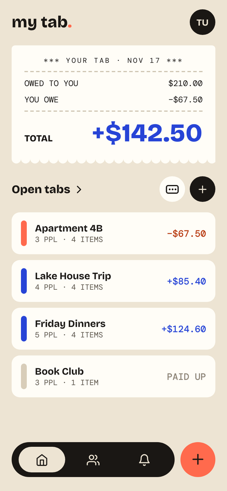
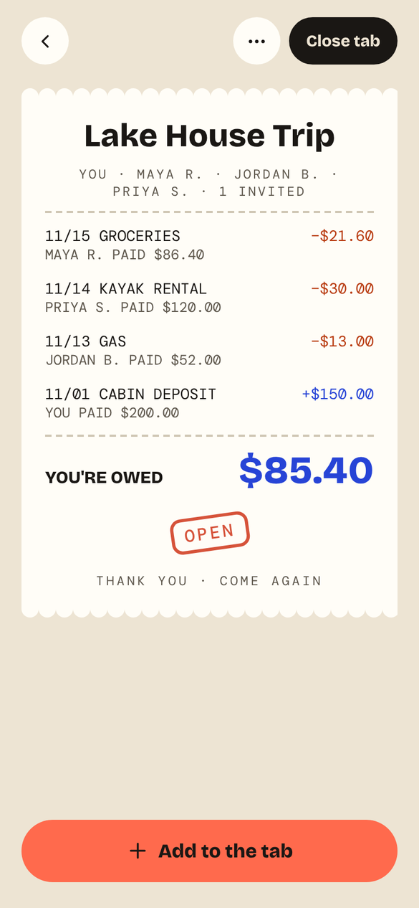
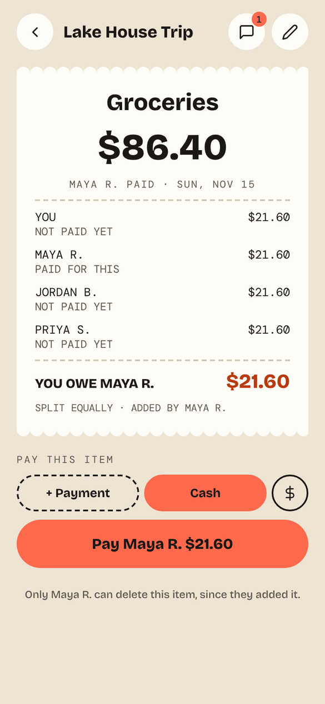
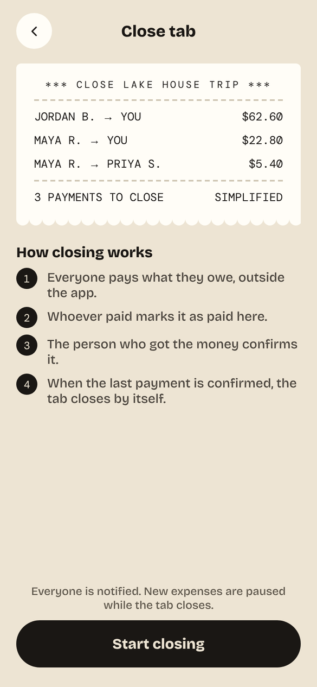

<div align="center">

# my tab.

**Keep a tab with your people.**

A shared expense tracker that looks like the receipt at the end of the night.
Log what everyone spent, see who owes what, pay each other back with the apps you already use,
and close the tab when everyone's square.

iOS · Android · Web, from one codebase

&nbsp;
&nbsp;
&nbsp;


</div>

> **Source is private** while My Tab is developed into a product. This repo is a showcase of what it does and how it's built. I'm happy to walk through the code on request: [oliver@oeich.com](mailto:oliver@oeich.com)

> **Status: working prototype.** The full app runs on in-memory demo data; the backend is next.

---

## See it in action

<div align="center">

</div>

## What it does

- **Tabs for any group:** a trip, a shared apartment, a standing dinner. Each tab prints as a receipt with every item and your balance at the bottom.
- **Fair splits:** split items equally, by exact amounts, or by percent. Money is stored in whole cents, so splits always add up.
- **One number per friend:** what you and a friend owe each other is netted across every tab you share, so one payment can clear them all.
- **Pay item by item:** pay off just your share of the groceries, and see who else still owes for it.
- **Pay with Venmo, Cash App, PayPal or Zelle:** My Tab opens the app with the person, amount and a short reference code filled in, then matches the transfer when you come back.
- **Close the tab:** My Tab works out the fewest payments needed to square up, pauses new items, and closes the tab by itself once the last payment is confirmed.
- **Built for real life:** works offline (changes wait as *Pending*), undo after deleting, phone-number sign-in, CSV export of everything you're part of.

My Tab only **records** payments. Money always moves in the payment app you choose.

## Interesting problems

- **Fewest payments to settle a group.** Closing a tab nets everyone's balances and computes a minimal set of transfers, so a group of six doesn't need fifteen payments to square up.
- **Netting across tabs.** Balances between two friends are combined across every shared tab, so one payment can clear several tabs at once.
- **Splits that always add up.** All money is integer cents. Leftover cents from uneven splits are assigned deterministically, so totals never drift by a penny.
- **Matching payments without a payment API.** Each hand-off to Venmo, Cash App, PayPal or Zelle carries a short reference code, which is used to match the transfer back to the right item.
- **Offline first.** Changes made offline are queued as *Pending* and applied when the connection returns.

## Tech

- [Expo](https://expo.dev) with Expo Router (file-based routing), one codebase for iOS, Android and web
- React Native + TypeScript, React Compiler enabled
- No UI library: a small custom design kit (receipts, stamps, scalloped paper edges)
- Unit-tested money logic (balance math, payment matching, CSV export); TypeScript type-checking and ESLint on every change

## How it's built

```
Screens (Expo Router)  →  one store (useStore)  →  money logic (plain TypeScript)
```

- Every screen talks to a single store, so the planned backend swaps in behind it without touching the UI.
- The money logic has no React Native imports, so it can move to a server unchanged.

## Next

- Backend: real accounts, a database and SMS sign-in
- Real payment confirmation
- Notifications and receipt photos

## Design

The look comes from a printed till receipt: kraft-paper background, monospaced line items, dashed dividers, scalloped edges and rubber stamps (`OPEN`, `PAID UP`, `CLOSED`). Blue means you're owed, rust means you owe, coral is for actions.

---

Built by [Oliver Eichenberg](https://oeich.com) · EICH
